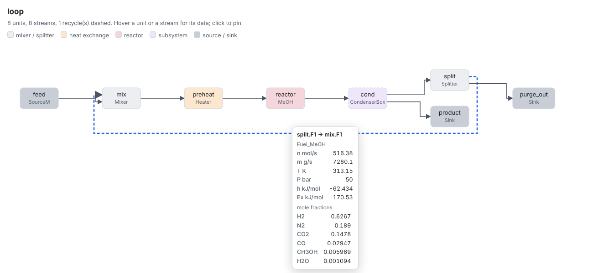

# Building and solving systems

Three tools on every `SysBase` system, independent of each other:

| | |
|---|---|
| `link(outlet, inlet)` | declare the streams once; the solve order and the tear streams are generated (see [recycles](recycles.md#declaring-the-flowsheet-instead)) |
| `add_spec(target, value, vary=...)` | design specifications instead of hand-written `Optimiser` methods |
| `pfd()` | interactive process flow diagram with stream tables on hover |

## Design specifications

```python
plant.add_spec('sink1.F0.n', 2.0, vary='source1.F1.n', bounds=(0.1, 10.0))
plant.add_spec(lambda s: s.sink1.F0.Xi[0], 0.45, vary='reformer.T', name='H2 fraction')
plant.solve_specs()
plant.specs            # table: value, current value, adjusted input, bounds
```

- `target`: a dotted path relative to the system (indices allowed: `'reactor.F1.Xi[6]'`, properties such as
  `'carbon_efficiency'`) or a function of the system.
- `vary`: the dotted path of the input that is adjusted (any attribute or property that can be set:
  `'feed.F1.n'`, `'heater.F1.T'`, `'split.split'`, `'reformer.T'`).
- All specifications are solved together with `solvers.solve` (bounded when `bounds` are given); every
  iteration is one full `run_sol` of the system, recycles included. `solve_specs(run=...)` takes another
  solve function, `clear_specs()` removes them.
- Residuals are divided by `scale` (default `|value|`), so specifications of different size are balanced.
- The derivatives are finite differences of a converged flowsheet: keep the recycle tolerance (`eps`) well
  below the spec tolerance (default 1e-8 relative). The equation-oriented form in the JAX layer
  (`examples/05_soec_flowsheet.py`) solves specifications with exact derivatives instead.

## Process flow diagram

```python
plant.run_sol()
plant.pfd('plant.html')     # or just `plant.pfd()` as the last line of a notebook cell
```



One self-contained HTML file: an SVG drawing and a few lines of JavaScript, no downloads, light and dark mode.
Hovering a stream shows n, m, T, P, h, Ex and the composition; hovering a unit its class, Q, W, exergy loss and
whether its solver converged. A click pins the table.

The streams drawn are the declared ones (`link`) or, for a system with a hand-written `seq_sol`, the connections
made by its last run. The layout is the layered method used by Graphviz dot and ELK: recycles are torn (dashed,
the same choice as `solve_order`), units are placed by their longest path from the feeds, the order within a
column is improved by barycentre sweeps, and the streams are routed orthogonally - recycles along lanes below
the units. Colours mark the unit type (heat exchange, reactor, electrochemical, separation, pressure change,
mixer/splitter, subsystem). `create_graph('mermaid')` and `create_graph('networkx')` remain available.
